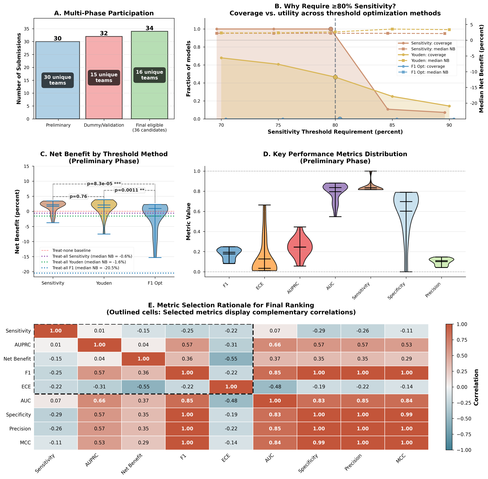
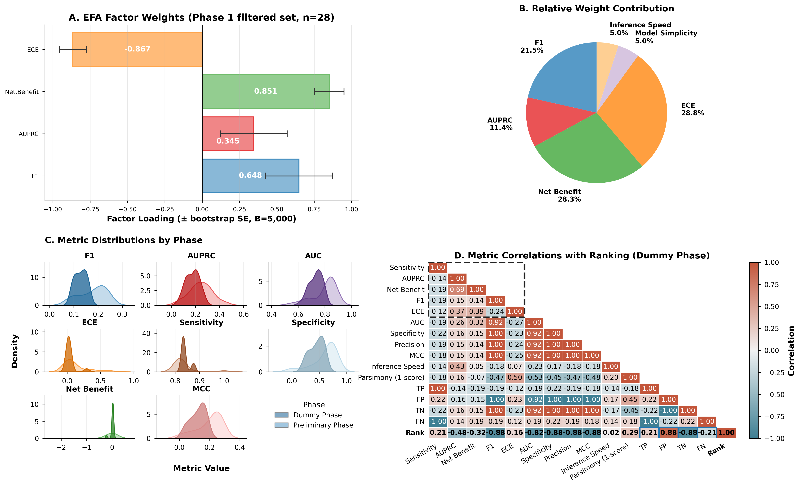
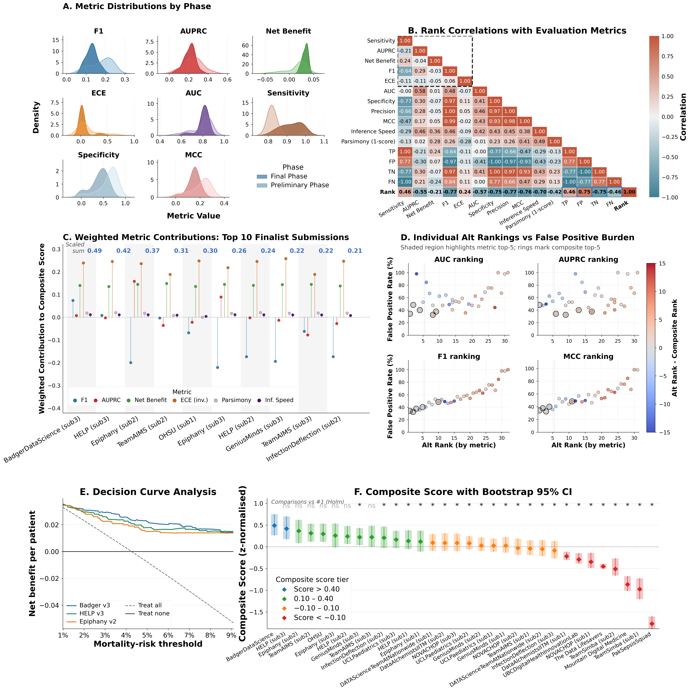
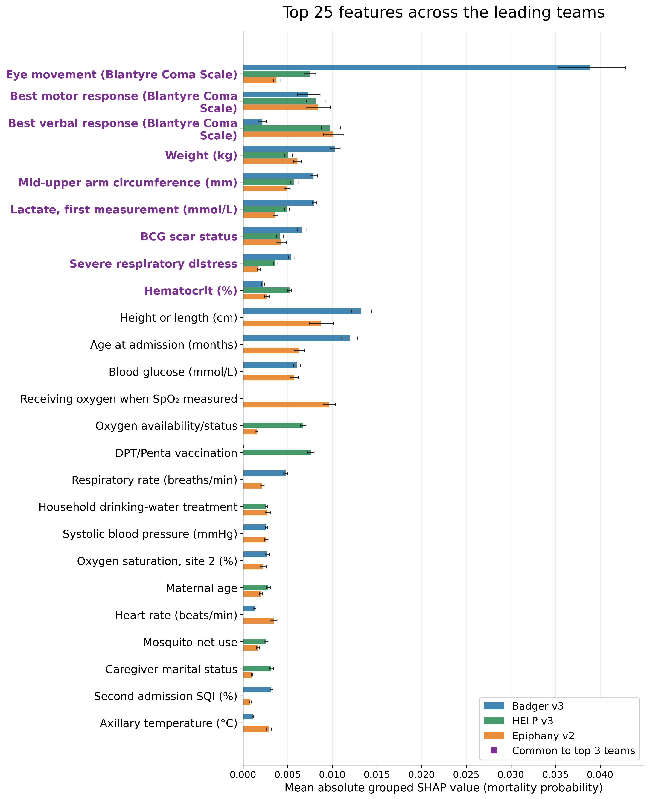

# Pediatric Sepsis Challenge: composite leaderboard analysis

This repository contains the paper figures and aggregate submission results for the Pediatric Sepsis Challenge. The current final leaderboard contains **34 eligible submissions from 16 teams**. Badger v3 ranks first (0.4891), followed by HELP v3 (0.4169) and Epiphany v2 (0.3659).

## Leaderboard

[Download the current leaderboard](data/raw/final_scores.csv). The CSV retains full-precision scores, submission identifiers, thresholds, confusion counts, calibration metrics and the submission-recorded runtime/parsimony terms. Displayed ranks use dense ranking of scores rounded to two decimals; rows follow continuous scores. Of 36 final candidates, 34 meet the sensitivity threshold of 0.80. Patient-level uncertainty summaries cover 32 eligible submissions with verified probability files.

## Main figures



**Figure 1.** Participation and threshold-based evaluation. Panel A shows 34 eligible final submissions from 36 candidates; Panels B–E retain the preliminary-phase analyses.



**Figure 2.** Factor-derived weighting and validation diagnostics. Panel A reports signed loadings with bootstrap standard errors from 5,000 development resamples.



**Figure 3.** Final-phase performance, rank correlations, weighted score contributions and alternative rankings. **E:** decision curves for Badger v3, HELP v3 and Epiphany v2, with treat-all and treat-none comparators. **F:** composite-score bootstrap 95% intervals and Holm-adjusted paired comparisons. The decision curves use 305 common thresholds (0.99–9.09%) on 1,151 final-test patients, including 49 deaths.



**Figure 4.** Mean absolute grouped SHAP values for the three leading models, expressed in mortality-probability units including calibration. Purple labels indicate features common to all three model-specific top-25 lists. Whiskers show conditional patient-bootstrap 95% intervals.

## Supplementary figures

- [Supplementary Figure 1](figures/supplementary/results_supplementary_figure1.png): fixed-decision Net Benefit sensitivity to FN:FP cost ratios, preliminary and final phases. Decision curves appear in main Figure 3E.
- [Supplementary Figure 2](figures/supplementary/results_supplementary_figure2.png): AUROC/AUPRC uncertainty and adjacent-rank comparisons.

## Run the existing main-figure scripts

```sh
git clone https://github.com/Kamaleswaran-Lab/Leaderboard-Analysis.git
cd Leaderboard-Analysis
python3 -m venv .venv
source .venv/bin/activate
pip install numpy pandas scipy matplotlib seaborn
python scripts/python/create_results_panels.py
```

The three main-figure scripts read the included aggregate inputs and regenerate **Figures 1–3** under `figures/main_figures/`. Figure 3 recomputes component contributions using the frozen primary formula and plots the supplied bootstrap and decision-curve summaries. It preserves exact submission-version matches and uses Holm-adjusted comparisons. Figures 4 and Supplementary Figures 1–2 are provided as the final reference images in this update.

This update publishes figure generation from aggregate inputs. Recomputing patient-level bootstraps, decision curves, model fitting or SHAP requires the corresponding patient-level data, predictions and fitted models, which are not included here. Manuscript drafts, reviewer responses, local analysis backups and exploratory notebooks are excluded from this update. Other previously committed scripts and notebooks are historical analysis utilities.
